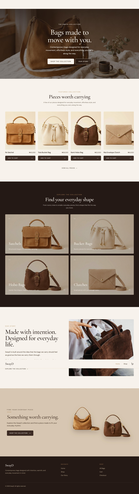

# SwayD

An e-commerce storefront for a suede handbag brand. Plus the Founder's initials

**Live site:** [https://swayyd.vercel.app]



## Overview

SwayD is a front-end e-commerce project built around a warm, editorial brand identity. It covers the full browsing-to-checkout journey: a landing page, a searchable shop, product detail pages, a persistent cart and a checkout form.

## Features

- **Landing page** with a hero, featured pieces, category cards, brand story and a call to action
- **Shop** with search, category filter and price sorting
- **Product pages** with a quantity selector and in-stock and out-of-stock states
- **Cart** that persists between visits using localStorage, with line totals and a subtotal
- **Checkout** with a form and an order summary (front-end only, no payment processing)
- **Naira pricing** formatted with `Intl.NumberFormat("en-NG")`
- **Navigation**: sticky navbar, full-screen mobile menu that closes on Escape, link tap and outside tap, and active route styling
- **Accessibility**: visible keyboard focus styles, text contrast checked against WCAG AA, descriptive alt text and ARIA attributes on the menu
- **Scroll reveal** animations below the fold


## Built with

- React 19
- Vite
- Tailwind CSS v4 (design tokens defined in `@theme`)
- react-router-dom
- Context API for cart state

## Design system

A warm suede palette and two typefaces: Cormorant Garamond for display text and DM Sans for the interface.

| Token | Hex | Used for |
|---|---|---|
| coffee | `#3b2923` | Primary text and buttons |
| cream | `#f7f2ea` | Page background |
| beige | `#d8c7b0` | Panels and surfaces |
| camel | `#b58b62` | Accents |
| deep-brown | `#241914` | Footer and dark sections |

Colours are registered as Tailwind v4 theme tokens (`bg-coffee`, `text-camel` and so on), so there are no arbitrary colour values in the components.

## Project structure

```
src/
  components/   Navbar, Hero, Categories, FeaturedProducts, ProductCard,
                BrandStory, CTA, Footer, ScrollReveal
  pages/        Home, Shop, ProductDetails, Cart, Checkout
  context/      CartContext (cart state and localStorage persistence)
  services/     productService (async access to the product catalog)
  data/         products.js (12 products)
public/
  images/products/   product photography
```

Other scripts: `npm run build` for a production build and `npm run lint` to lint.

## Notes

- The product catalog is local data in `src/data/products.js`. The service layer returns promises, so it can be pointed at a real API later without changing the components.


